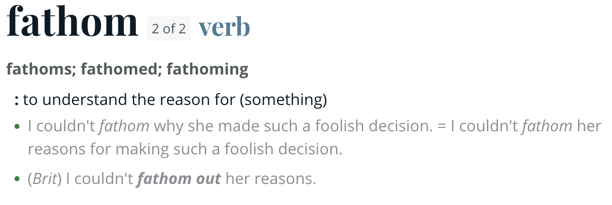

# fathom: Qualitative Coding and Measurement with Local Language Models

<div align="center">
  
</div>

The `fathom` R package is a toolkit for qualitative coding and measurement of a corpus of text, images, audio, or video with *local* large language models (LLMs), where every answer comes back as a probability rather than a word.

With the function `measure()`, R users can ask an Ollama-hosted LLM a constrained set of labeled questions about a corpus document and get back the model's next-token probability distribution for those constrained labels. The questions themselves are built and bundled with the function `instrument()`. The function `item_report()` provides a clear summary of how each question behaved across the entire corpus, while the function `inspect_cases()` displays documents that the model answered with a specific label. The function `as_wide()` prepares the output for any downstream analysis by pivoting the results so that each row is one document and each question becomes a column. To audit the model's answers, the function `coding_sample()` samples a random set of document-question pairs for human validation, which is then executed through the function `validate_sample()`.

## Motivation

Getting an LLM's response about a question provides no insight as to how confident it was in determining that answer. This is further obfuscated if a prompt does not provide a clear and explicit instruction to answer with a set of constrained response labels. Constraining a labeled set of responses and extracting their log probabilities allows a user to use the responses as a classification tool or continuous measurement item. Additionally, being able to read a model's probability distribution allows a user to assess how much probability mass was placed on each of the labels, revealing the presence of a compound question, a missing category, or a bad prompt.

## The fathom workflow

<details>
<summary><strong>0. Prepare the corpus (non-text corpora)</strong></summary>

**`prepare_image()`**

- Turns a set of image files into a valid corpus, where each row is one image filepath alongside its file size.

**`prepare_audio()`**

- Turns a set of audio files into a valid corpus by using an Automatic Speech Recognition (ASR) model to transcribe each recording to text.

**`prepare_video()`**

- Turns a set of video files into a valid corpus, where each row is one video holding its extracted frames alongside an ASR transcript of its audio.

</details>

<details>
<summary><strong>1. Prepare a local model</strong></summary>

**`ollama_backend()`**

- Connects to a local [Ollama](https://ollama.com) server and confirms the model is installed.
- Called with no model name, lists the models the server has installed, so it doubles as a way to confirm the server is running.
- Works with an instruction-following model whose first generated token is a label, including one that reasons by default, since reasoning is disabled on every call.

</details>

<details>
<summary><strong>2. Write the coding instrument</strong></summary>

**`instrument()`**

- Bundles the questions with the single-word labels the model may answer with.
- Questions themselves can be of any length and consist of anything a user wants the model to read alongside the corpus.
- Questions can be structured as (1) independent items or (2) exclusive items.
  - Independent items ask a separate binary question for each category, meaning that a document can match several at once.
  - Exclusive items make the categories the labels of a single question, meaning that they share a single distribution.
- Exclusive items are the right choice when a document takes exactly one category, such as a level on a scale, or when the categories are defined against each other, since the model then needs to see all of them to tell them apart.

**`template_items()` (optional)**

- Builds the questions for an instrument of independent items by inserting each category from a list into one question template. 
- Templates can be written by the user or chosen from a provided set that comes in English and Spanish for each type of corpus (text, image, audio, and video).

**`preview()` (optional)**

- Prints a preview of the exact string that the model will receive, before Ollama applies the model's chat template.

</details>

<details>
<summary><strong>3. Extract response probabilities</strong></summary>

**`measure()`**

- Calls the LLM with an instrument of questions and labels over a data frame or a character vector of documents, where each call processes one document and one question.
- Returns an object containing (1) a table holding the probability of every label for each document-question pair and (2) a table holding details for each document-question pair, including the model's first response token, the share of probability that fell outside the constrained labels, and the probability gap between the top two labels.
- If given a checkpoint folder, the run saves one file per document, allowing an interrupted run to pick up where it left off when called again on the same folder.

</details>

<details>
<summary><strong>4. Summarize the results</strong></summary>

**`item_report()`**

- Summarizes how each question was answered by the model across the corpus.
- For questions with only two labels (e.g., "yes"/"no"), it reports how often the model chose the label of interest (e.g., how often it answered "yes" over "no" or vice versa), how often it was close to certain with probabilities near 0 or 1, the average probability it placed on words outside the specified labels, and how often its first word was either of the two.
- For questions with more than two labels, such as most exclusive items, it reports how often each label won.

**`inspect_cases()` (optional)**

- Prints the full text of a sample of documents where a question's target label won (e.g., text where the model answered "yes"), allowing a user to gut-check the model's answers.
- It can also print the model's most uncertain calls, where the gap between the top and runner-up labels was the smallest (e.g., text where the model put nearly equal probability on "yes" and "no").

**`as_wide()`**

- Pivots the first table from `measure()` into one row per document and one column per question, each holding the probability of the target label (e.g., the probability of "yes"). For exclusive items or a single question, each label gets its own column instead.
- With `dichotomize = TRUE`, returns 0 or 1 instead of probabilities, cut at 0.5.
- With `value = "expected_score"`, returns each document's expected score on each question, the average of the label scores weighted by their probabilities, which requires an instrument built with `scores`.

</details>

<details>
<summary><strong>5. Validate response probabilities</strong></summary>

**`coding_sample()`**

- Draws a seeded random sample of document-question pairs into an exportable data frame coding sheet.
- Every pair has a uniform chance of being drawn.

**`coder_reference()` (optional)**

- Consolidates two or more completed `coding_sample()` sheets into one, allowing a group of coders to serve as the single reference for `validate_sample()`.
- Its default method of consolidation is majority rule, but it can also consolidate based on unanimous agreement (`method = "unanimous"`) or instead report the smoothed share of coders who chose the target label (`method = "soft"`).
- Ties are left blank.

**`validate_sample()`**

- Validates the model's answers from `measure()` against a completed `coding_sample()` sheet in terms of discrimination and ranking, with calibration on request.
- If given a named list of `coding_sample()` sheets, it also reports intercoder reliability and how far the model's responses are from the coders, the latter with a bootstrap confidence interval.

</details>

<details>
<summary><strong>6. Get measurement diagnostics (optional)</strong></summary>

**`threshold_sensitivity()`**

- Reports endorsement rates at a range of cut points.

**`order_sensitivity()`**

- Measures every document (or a seeded sample of them) again with the labels reversed, and reports how often the responses changed.
- Questions with three or more labels also do a second run with shuffled labels.

</details>

## Requirements

A running [Ollama](https://ollama.com) server at version 0.12.11 or later, and a [compatible](articles/quick_start.html) Ollama instruction-following model.

[`ffmpeg`](https://www.ffmpeg.org/) for measuring audio and video.

[`whisperx`](https://github.com/m-bain/whisperx) or [`whispermlx`](https://github.com/KalebJS/whispermlx) (Apple Silicon optimized) for measuring audio and video, with a Hugging Face [User Access Token](https://huggingface.co/docs/hub/en/security-tokens) and access to the [Community-1](https://huggingface.co/pyannote/speaker-diarization-community-1) model to use speaker diarization.

See the [Quick start](articles/quick_start.html) page for information on how to set each of these up.

## Installation

`fathom` is distributed through R-universe.

```r
install.packages(
  "fathom",
  repos = c("https://alcocer-jj.r-universe.dev", "https://cloud.r-project.org")
)
```

The development version installs from GitHub.

```r
# install.packages("pak")
pak::pak("alcocer-jj/fathom")
```

## Acknowledgments

Development of this package was assisted by [Claude Code](https://claude.com/product/claude-code), an AI coding assistant by Anthropic, for code review, documentation building, vignette drafting, and the validation components.
